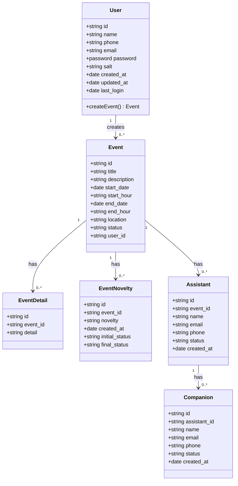

# Diagrama de Clases

Este documento describe el diagrama de clases de la aplicación **EventsApp**, derivado del modelo entidad-relación definido en [erDiagram.mmd](./diagrams/erDiagram.mmd).

## Diagrama

> El código fuente del diagrama se encuentra en [classDiagram.mmd](./diagrams/classDiagram.mmd).

## Descripción

El diagrama de clases representa las entidades principales del sistema de gestión de eventos y las relaciones que existen entre ellas.

### Clases

- **User (Usuario):** representa a la persona registrada en la plataforma. Almacena sus datos de contacto (`name`, `phone`, `email`) y credenciales (`password`). Es responsable de crear eventos mediante la operación `createEvent()`.
- **Event (Evento):** entidad central del sistema. Contiene la información del evento como título, descripción, fechas y horas de inicio y fin, ubicación y estado (`scheduled`, `completed`, `canceled`). Está vinculado a su creador a través de `user_id`.
- **EventDetail (Detalle del Evento):** almacena información adicional o descriptiva asociada a un evento específico.
- **EventNovelty (Novedad del Evento):** registra novedades o incidencias ocurridas durante el ciclo de vida del evento, con seguimiento de su estado inicial (`initial_status`) y final (`final_status`).
- **Assistant (Asistente):** representa a las personas invitadas o registradas para asistir a un evento, con sus datos de contacto y estado (`active`, `inactive`).
- **Companion (Acompañante):** representa a los acompañantes que un asistente puede llevar al evento, vinculados mediante `assistant_id`.

### Relaciones

| Origen | Destino | Cardinalidad | Descripción |
|--------|---------|--------------|-------------|
| User | Event | 1 a 0..* | Un usuario puede crear muchos eventos. |
| Event | EventDetail | 1 a 0..* | Un evento puede tener muchos detalles. |
| Event | EventNovelty | 1 a 0..* | Un evento puede tener muchas novedades. |
| Event | Assistant | 1 a 0..* | Un evento puede tener muchos asistentes. |
| Assistant | Companion | 1 a 0..* | Un asistente puede tener muchos acompañantes. |

Todas las relaciones son de composición/agregación de tipo **uno a muchos (1 a N)**, donde la entidad padre puede tener cero o más entidades hijas asociadas.
