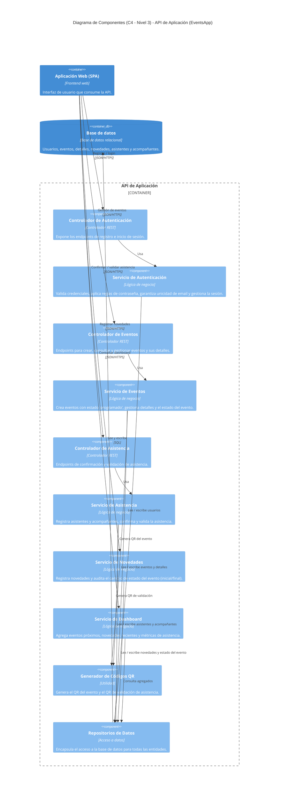

# Diagrama de Componentes (C4 - Nivel 3)

Este documento presenta el **diagrama de componentes** de la aplicación **EventsApp**, siguiendo el modelo **C4 (nivel 3: Component)**. Amplía el [diagrama de contenedores](./container_diagram.md) haciendo *zoom* dentro del contenedor **API de Aplicación**, para mostrar los componentes que lo forman y sus responsabilidades.

Fue construido a partir de las especificaciones de [docs/features/](../features/) y del modelo de datos definido en [database.md](./database.md).

> **Nota sobre el stack tecnológico:** el archivo [tech_stack.md](../tech_stack.md) aún está vacío. Los tipos de componente (controlador REST, servicio de negocio, repositorio) son **valores de referencia** de una arquitectura web por capas; deben ajustarse cuando se defina el stack definitivo.

## Diagrama

> El código fuente del diagrama se encuentra en [componentDiagram.mmd](../diagrams/componentDiagram.mmd).

## Descripción

El diagrama hace *zoom* dentro del contenedor **API de Aplicación** y organiza sus componentes en tres capas: **controladores REST** (entrada), **servicios de negocio** (reglas) y **acceso a datos** (persistencia), más una utilidad transversal para códigos QR.

### Componentes por feature

- **Autenticación** — *Controlador* + *Servicio de Autenticación*. Cubre las features [register_user](../features/register_user.md) y [user_login](../features/user_login.md): valida datos, aplica reglas de contraseña, garantiza la unicidad del email y verifica credenciales.
- **Eventos** — *Controlador* + *Servicio de Eventos*. Cubre [create_event](../features/create_event.md): crea el evento con estado inicial `programado`, gestiona los detalles y el estado del evento. Solicita al *Generador de QR* el código QR del evento.
- **Asistencia** — *Controlador* + *Servicio de Asistencia*. Cubre [confirm_assistance](../features/confirm_assistance.md) y [validate_assistance](../features/validate_assistance.md): registra asistentes y acompañantes, confirma la asistencia y la valida el día del evento. Solicita al *Generador de QR* el código QR de validación.
- **Novedades** — *Servicio de Novedades*. Cubre [event_novelties](../features/event_novelties.md): registra la novedad y audita el cambio de estado del evento (estado inicial y final).
- **Dashboard** — *Servicio de Dashboard*. Cubre [dashboard](../features/dashboard.md): agrega eventos próximos, novedades recientes y métricas de asistencia.

### Componentes transversales

- **Generador de Códigos QR:** utilidad compartida por los servicios de Eventos y Asistencia para producir tanto el QR del evento como el QR de validación.
- **Repositorios de Datos:** capa de acceso a datos que encapsula la lectura/escritura contra la base de datos para todas las entidades (`USERS`, `EVENTS`, `EVENT_DETAILS`, `EVENT_NOVELTIES`, `ASSISTANTS`, `COMPANIONS`).

### Elementos externos al contenedor

- **Aplicación Web (SPA):** consume los endpoints de la API sobre JSON/HTTPS.
- **Base de datos:** almacén relacional accedido exclusivamente a través de los *Repositorios de Datos* mediante SQL.

### Notas de diseño

- Los servicios de **Novedades** y **Dashboard** se muestran sin controlador dedicado por simplicidad; en la implementación real expondrían su propio controlador REST igual que los demás.
- La separación controlador / servicio / repositorio es una convención de referencia; el detalle final dependerá del framework elegido y se registrará en [tech_stack.md](../tech_stack.md).
