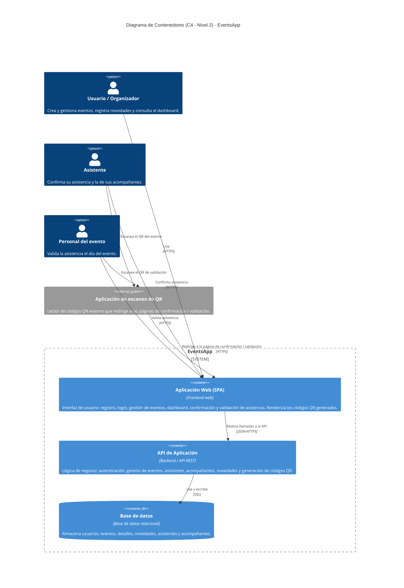

# Diagrama de Contenedores (C4 - Nivel 2)

Este documento presenta el **diagrama de contenedores** de la aplicación **EventsApp**, siguiendo el modelo **C4 (nivel 2: Container)**. Amplía el [diagrama de contexto](./context_diagram.md) mostrando las piezas ejecutables (aplicaciones y almacenes de datos) que componen el sistema y cómo se comunican entre sí.

Fue construido a partir de las especificaciones de [docs/features/](./features/) y del modelo de datos definido en [database.md](./database.md).

> **Nota sobre el stack tecnológico:** el archivo [tech_stack.md](./tech_stack.md) aún está vacío. Los tipos de tecnología indicados (SPA, API REST, base de datos relacional) son **valores de referencia** basados en que EventsApp es una aplicación web; deben ajustarse cuando se defina el stack definitivo.

## Diagrama

> El código fuente del diagrama se encuentra en [containerDiagram.mmd](./diagrams/containerDiagram.mmd).

## Descripción

### Contenedores de EventsApp

- **Aplicación Web (SPA):** frontend con el que interactúan los tres actores. Ofrece las pantallas de registro, inicio de sesión, creación y gestión de eventos, dashboard, y las páginas de confirmación y validación de asistencia. Muestra los códigos QR generados por el backend y consume la API mediante llamadas JSON sobre HTTPS.
- **API de Aplicación:** backend que concentra la lógica de negocio. Responsable de la autenticación de usuarios, la gestión de eventos y sus detalles, el registro de asistentes y acompañantes, el registro de novedades con auditoría de estados (inicial/final) y la generación de los códigos QR de evento y de validación. Lee y escribe en la base de datos.
- **Base de datos:** almacén relacional que persiste las entidades del modelo de datos: `USERS`, `EVENTS`, `EVENT_DETAILS`, `EVENT_NOVELTIES`, `ASSISTANTS` y `COMPANIONS`.

### Actores

- **Usuario / Organizador**, **Asistente** y **Personal del evento**: descritos en el [diagrama de contexto](./context_diagram.md). Todos interactúan con el sistema a través de la Aplicación Web (SPA).

### Sistema externo

- **Aplicación de escaneo de QR:** lector de códigos QR externo utilizado por el asistente (para escanear el QR del evento) y por el personal del evento (para escanear el QR de validación). Redirige al usuario a la página correspondiente de la SPA.

### Flujos principales

1. **Autenticación y gestión:** el organizador usa la SPA → la SPA llama a la API → la API valida/persiste en la base de datos.
2. **Confirmación de asistencia:** el asistente escanea el QR con la app externa → es redirigido a la SPA → la SPA consulta la API → la API registra la asistencia y acompañantes en la base de datos y genera el QR de validación.
3. **Validación de asistencia:** el personal escanea el QR de validación → es redirigido a la SPA → la API verifica el registro y actualiza el estado de asistencia.

### Notas de diseño

- La **generación de códigos QR** se modela como una responsabilidad interna de la **API**; en el nivel 3 (Componentes) podría representarse como un componente/servicio dedicado.
- Los protocolos indicados (HTTPS, JSON, SQL) son orientativos y dependerán del stack definitivo registrado en [tech_stack.md](./tech_stack.md).
