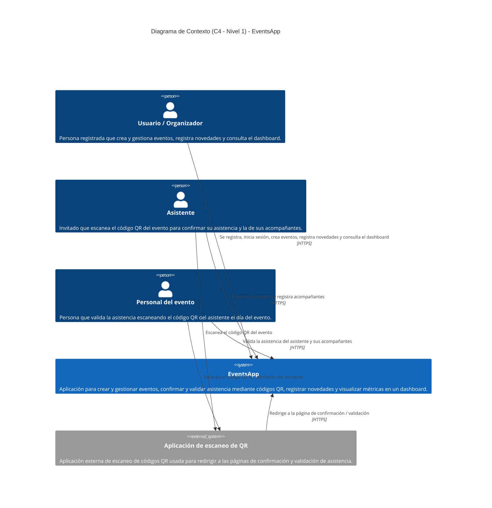

# Diagrama de Contexto (C4 - Nivel 1)

Este documento presenta el **diagrama de contexto** de la aplicación **EventsApp**, siguiendo el estilo del modelo **C4 (nivel 1: System Context)**. Fue construido a partir de las especificaciones funcionales ubicadas en [docs/features/](./features/).

El objetivo de este nivel es mostrar el sistema como una caja negra, junto con los **actores (personas)** que interactúan con él y los **sistemas externos** de los que depende, sin entrar en detalles internos de implementación.

## Diagrama

> El código fuente del diagrama se encuentra en [contextDiagram.mmd](./diagrams/contextDiagram.mmd).

## Descripción

### Sistema central

- **EventsApp:** sistema objeto de este diagrama. Concentra la gestión completa del ciclo de vida de un evento: registro e inicio de sesión de usuarios, creación de eventos con generación de código QR, confirmación de asistencia por parte de invitados, validación de asistencia el día del evento, registro de novedades con auditoría de estados, y un dashboard con métricas y accesos rápidos.

### Actores (personas)

- **Usuario / Organizador:** actor principal. Se registra e inicia sesión, crea y gestiona eventos, registra novedades (reprogramación, cancelación, suspensión, etc.) y consulta el dashboard con eventos próximos, novedades recientes y estadísticas. Deriva de las features *register_user*, *user_login*, *create_event*, *event_novelties* y *dashboard*.
- **Asistente:** invitado del evento. Escanea el código QR del evento para acceder a la página de confirmación, confirma su asistencia y registra a sus acompañantes. Deriva de la feature *confirm_assistance*.
- **Personal del evento:** encargado de controlar el acceso el día del evento. Escanea el código QR de validación que presenta el asistente para verificar su registro y confirmar su presencia. Deriva de la feature *validate_assistance*.

### Sistemas externos

- **Aplicación de escaneo de QR:** aplicación externa (cualquier lector de códigos QR del dispositivo del usuario) utilizada tanto por el asistente como por el personal del evento. Su función es leer el código QR y redirigir al usuario a la página correspondiente de confirmación o validación dentro de EventsApp.

### Notas de diseño

- La **base de datos** no aparece en este diagrama porque, en el modelo C4, es un componente **interno** de EventsApp y se representa en el nivel de contenedores (C4 - Nivel 2), no en el diagrama de contexto.
- Las relaciones de los actores con EventsApp se modelan sobre **HTTPS**, asumiendo el acceso a través de la interfaz web/móvil de la aplicación.
