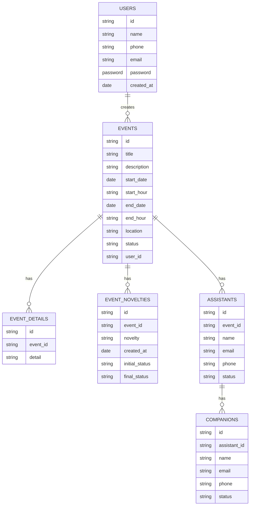

# Database Design

## Initial version

## Dictionary

### Table: USERS

| Column Name | Data Type | Description |
|-------------|-----------|-------------|
| id          | string    | Unique identifier for the user |
| name        | string    | Name of the user |
| phone       | string    | Phone number of the user |
| email       | string    | Email address of the user |
| password    | password  | Password of the user |
| created_at  | date      | Date the user was created |

### Table: EVENTS

| Column Name | Data Type | Description |
|-------------|-----------|-------------|
| id          | string    | Unique identifier for the event |
| title       | string    | Title of the event |
| description | string    | Description of the event |
| start_date  | date      | Start date of the event |
| start_hour  | string    | Start hour of the event |
| end_date    | date      | End date of the event |
| end_hour    | string    | End hour of the event |
| location    | string    | Location of the event |
| status      | string    | Status of the event (e.g., `scheduled`, `completed`, `canceled`) |
| user_id     | string    | ID of the user who created the event |

### Table: EVENT_DETAILS

| Column Name | Data Type | Description |
|-------------|-----------|-------------|
| id          | string    | Unique identifier for the event detail |
| event_id    | string    | ID of the associated event |
| detail      | string    | Detail information about the event |

### Table: EVENT_NOVELTIES

| Column Name | Data Type | Description |
|-------------|-----------|-------------|
| id          | string    | Unique identifier for the event novelty |
| event_id    | string    | ID of the associated event |
| novelty     | string    | Description of the novelty |
| created_at  | date      | Date the novelty was created |
| initial_status | string | Initial status of the novelty |
| final_status | string   | Final status of the novelty |

### Table: ASSISTANTS

| Column Name | Data Type | Description |
|-------------|-----------|-------------|
| id          | string    | Unique identifier for the assistant |
| event_id    | string    | ID of the associated event |
| name        | string    | Name of the assistant |
| email       | string    | Email address of the assistant |
| phone       | string    | Phone number of the assistant |
| status      | string    | Status of the assistant (e.g., `active`, `inactive`) |
| created_at  | date      | Date the assistant was created |

### Table: COMPANIONS
| Column Name | Data Type | Description |
|-------------|-----------|-------------|
| id          | string    | Unique identifier for the companion |
| assistant_id | string   | ID of the associated assistant |
| name        | string    | Name of the companion |
| email       | string    | Email address of the companion |
| phone       | string    | Phone number of the companion |
| created_at  | date      | Date the companion was created |
| status      | string    | Status of the companion (e.g., `active`, `inactive`) |

