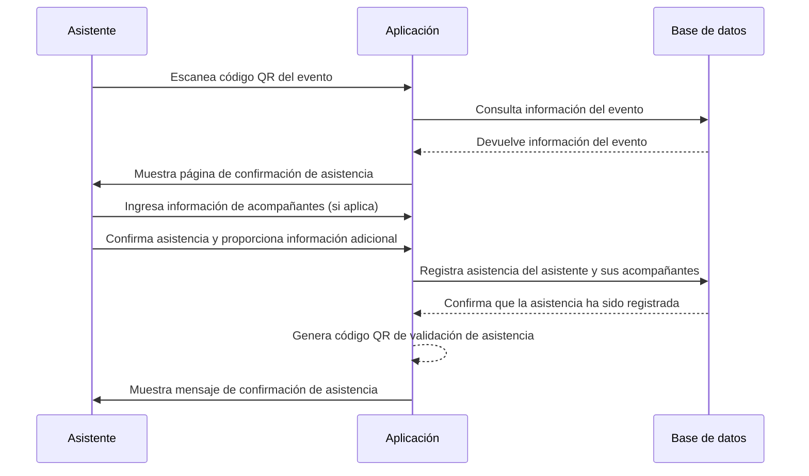

# Confirmar asistencia

## Overview

Dado un evento creado, EventsApp le entrega al usuario un código QR que puede ser escaneado por los invitados que designe el usuario de manera libre.

El asistente escanea el código QR en cualquier aplicación de escaneo de códigos QR y este lo redirecciona a la página de confirmación de asistencia del evento en la aplicación. En esta página, el asistente puede confirmar su asistencia al evento y proporcionar información adicional si es necesario.

Un asistente puede registrar uno o varios acompañantes, quienes también podrán confirmar su asistencia al evento. La aplicación permite que el asistente y sus acompañantes puedan confirmar su asistencia de manera rápida y sencilla.

Al final, la aplicación registra la asistencia del invitado y sus acompañantes, actualiza el estado de asistencia en la base de datos y muestra un mensaje de confirmación al asistente con información del evento.

EventsApp genera un código QR con información para validar la asistencia del evento que debe ser presentada el día del evento por el asistente.

## Flujo de secuencia

## Criterios de aceptación

1. La aplicación debe permitir a los asistentes escanear el código QR del evento para acceder a la página de confirmación de asistencia.
2. La aplicación debe mostrar la información del evento al asistente después de escanear el código QR.
3. La aplicación debe permitir a los asistentes ingresar información de acompañantes si es necesario.
4. La aplicación debe registrar la asistencia del asistente y sus acompañantes en la base de datos una vez que confirmen su asistencia.
5. La aplicación debe generar un código QR de validación de asistencia que pueda ser presentado el día del evento.
6. La aplicación debe mostrar un mensaje de confirmación al asistente indicando que su asistencia ha sido registrada exitosamente y proporcionando información relevante del evento.
7. La aplicación debe manejar de manera segura la información de los asistentes y sus acompañantes, asegurando que la información sensible no se exponga ni se almacene de manera insegura.
8. La aplicación debe permitir a los asistentes cancelar su asistencia si es necesario, actualizando el estado de asistencia en la base de datos y mostrando un mensaje de confirmación de cancelación.