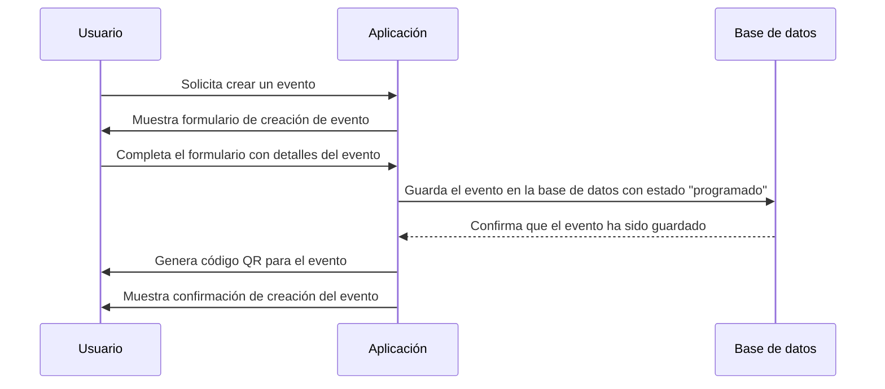

# Crear evento.

## Overview

Un usuario tiene la capacidad de crear un evento para celebrar algún momento o hito especial o para organizar una reunión o actividad. La creación de eventos es una funcionalidad central de la aplicación, ya que permite a los usuarios gestionar y coordinar sus actividades de manera eficiente.

Esta función permite a los usuarios crear nuevos eventos, especificando detalles como título, descripción, fecha inicial con hora, fecha final con hora, hora y ubicación.

Al final, el usuario puede guardar el evento, lo que lo añade a la lista de eventos del usuario y permite su posterior gestión y seguimiento. Dicho evento queda con un estado inicial de "programado", indicando que está planificado y pendiente de realización.

Adicionalmente, EventsApp genera un código QR a un espacio dentro de la misma app, la cual permite a los invitados confirmar su asistencia al evento de manera rápida y sencilla, escaneando el código QR proporcionado por el usuario.

## Flujo de secuencia

## Criterios de aceptación

1. La aplicación debe permitir a los usuarios ingresar los detalles del evento, incluyendo título, descripción, fecha inicial con hora, fecha final con hora, hora y ubicación.
2. La aplicación debe validar los datos ingresados por el usuario para asegurarse de que sean correctos y completos antes de guardar el evento.
3. La aplicación debe guardar el evento en la base de datos con un estado inicial de "programado" una vez que el usuario confirme la creación del evento.
4. La aplicación debe generar un código QR único para el evento creado, que pueda ser escaneado por los invitados para confirmar su asistencia.
5. La aplicación debe mostrar una confirmación al usuario indicando que el evento ha sido creado exitosamente y que el código QR ha sido generado.
6. La aplicación debe manejar de manera segura los datos del evento, asegurando que la información sensible no se exponga ni se almacene de manera insegura.
7. La aplicación debe permitir a los usuarios editar o eliminar eventos creados, siempre y cuando el evento no haya comenzado o haya sido cancelado, y debe actualizar el estado del evento en la base de datos según corresponda.