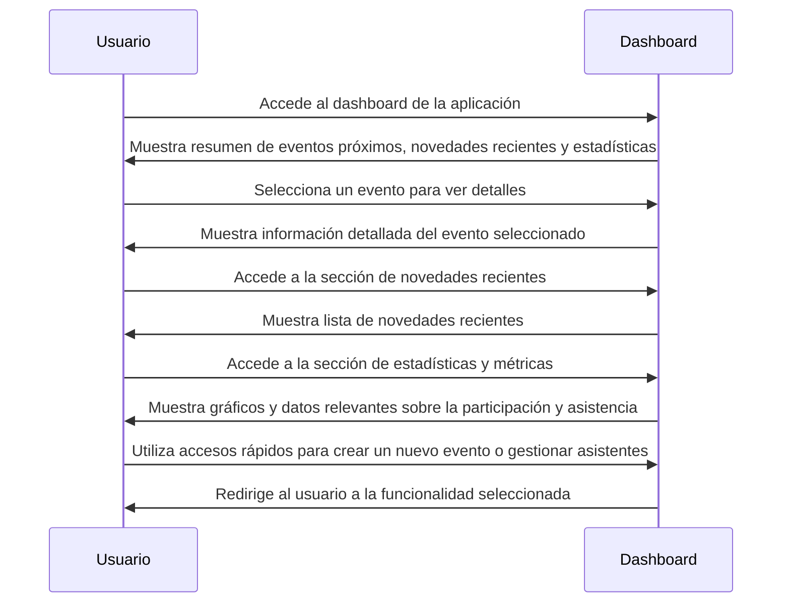

# Dashboard de aplicación

## Overview

El dashboard de la aplicación es una interfaz que permite a los usuarios visualizar y gestionar la información relacionada con los eventos y las novedades.

Muestra un resumen de los eventos próximos, las novedades recientes y proporciona acceso rápido a las funcionalidades principales de la aplicación.

También muestra estadísticas y métricas relevantes, como el número de asistentes confirmados, la cantidad de novedades publicadas y otros datos importantes para los organizadores de eventos.

## Secciones del Dashboard

- **Eventos Próximos**: Muestra una lista de los eventos que se llevarán a cabo próximamente, con información básica como fecha, hora y ubicación.
- **Novedades Recientes**: Presenta las últimas noticias y actualizaciones relacionadas con los eventos y la aplicación.
- **Estadísticas y Métricas**: Proporciona gráficos y datos sobre la participación de los asistentes, la asistencia confirmada y otros indicadores clave.
- **Accesos Rápidos**: Botones o enlaces que permiten a los usuarios acceder rápidamente a funciones importantes, como crear un nuevo evento, gestionar asistentes o ver detalles de un evento específico.

## Beneficios del Dashboard

- Facilita la gestión de eventos al centralizar la información en un solo lugar.
- Permite a los organizadores tomar decisiones informadas basadas en datos y métricas.
- Mejora la experiencia del usuario al proporcionar un acceso rápido a las funcionalidades más utilizadas.

## Flujo de secuencia

## Criterios de aceptación

1. La aplicación debe permitir a los usuarios acceder al dashboard desde la página principal o el menú de navegación.
2. La aplicación debe mostrar un resumen de los eventos próximos, incluyendo información básica como fecha, hora y ubicación.
3. La aplicación debe mostrar las novedades recientes relacionadas con los eventos y la aplicación.
4. La aplicación debe proporcionar estadísticas y métricas relevantes sobre la participación de los asistentes y la asistencia confirmada.
5. La aplicación debe ofrecer accesos rápidos a funciones importantes, como crear un nuevo evento, gestionar asistentes o ver detalles de un evento específico.
6. La aplicación debe permitir a los usuarios seleccionar un evento para ver información detallada, incluyendo descripción, lista de asistentes y estado del evento.
7. La aplicación debe permitir a los usuarios acceder a la sección de novedades recientes y ver la lista completa de noticias y actualizaciones.
8. La aplicación debe permitir a los usuarios acceder a la sección de estadísticas y métricas, mostrando gráficos y datos relevantes sobre la participación y asistencia.
9. La aplicación debe redirigir a los usuarios a la funcionalidad seleccionada cuando utilicen los accesos rápidos, asegurando una navegación fluida y eficiente dentro de la aplicación.