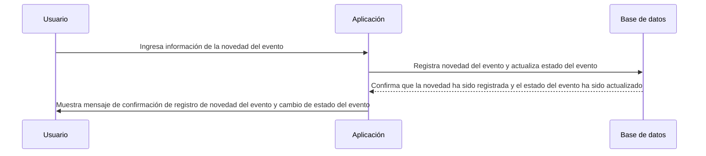

# Registrar novedades del evento

## Overview

Un evento puede tener novedades tanto geográficas, de seguridad, de logística, de programación, entre otras. Estas novedades pueden ser registradas por el usuario y notificadas a los asistentes a través de la aplicación.

Un usuario al seleccionar un evento creado y programado, puede registrar novedades por medio de la aplicación, ingresando la información de la novedad tales como la novedad, fecha y hora de la novedad. 

La aplicación permite cambiar el estado del evento por medio de una novedad, es decir, si el evento ha sido reprogramado, cancelado o suspendido, el usuario puede registrar la novedad y cambiar el estado del evento. La auditoría de los estados deben quedar registrados en el mismo registro de la novedad, es decir, el estado inicial y el estado final del evento.

## Flujo de secuencia

## Criterios de aceptación

1. La aplicación debe permitir a los usuarios ingresar la información de la novedad del evento, incluyendo la novedad, fecha y hora de la novedad.
2. La aplicación debe registrar la novedad del evento en la base de datos y actualizar el estado del evento si es necesario.
3. La aplicación debe mostrar un mensaje de confirmación al usuario indicando que la novedad del evento ha sido registrada exitosamente y que el estado del evento ha sido actualizado.
4. La aplicación debe manejar de manera segura la información de la novedad del evento, asegurando que la información sensible no se exponga ni se almacene de manera insegura.
5. La aplicación debe permitir a los usuarios ver un historial de novedades del evento, incluyendo la información de la novedad, fecha y hora de la novedad, y el estado del evento antes y después de la novedad.
6. La aplicación debe implementar medidas de seguridad adicionales, como la protección contra el acceso no autorizado a la información de novedades del evento y la verificación de la autenticidad de las solicitudes de registro de novedades del evento.

