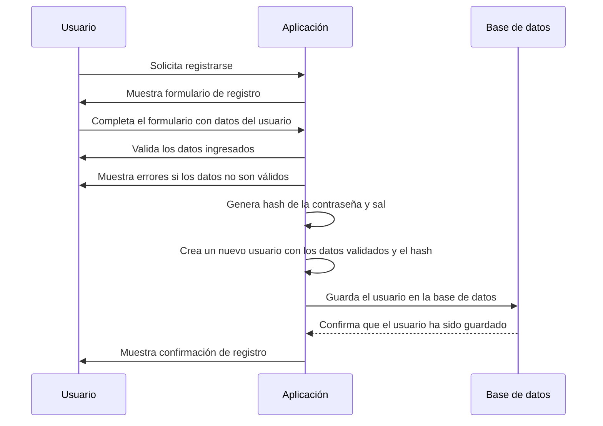

# Registrar usuario

## Overview

EventsApp permite crear una cuenta de usuario para acceder a funciones personalizadas y guardar preferencias. Este documento describe el proceso de registro de usuario en la aplicación.

La aplicación tendrá una página de registro (Sign Up) donde los usuarios pueden crear una cuenta proporcionando información básica como nombre, correo electrónico y contraseña. Una vez completado el formulario de registro, la aplicación validará los datos ingresados y creará una nueva cuenta de usuario en la base de datos.

El registro debe ser único y no pueden haber dos usuarios con el mismo correo electrónico. Además, la contraseña debe cumplir con ciertos criterios de seguridad, como longitud mínima y complejidad.

Al final, el usuario recibirá una confirmación de que su cuenta ha sido creada exitosamente y podrá iniciar sesión en la aplicación utilizando sus credenciales.

## Flujo de secuencia

## Endpoint

- `POST /v1/auth/register`: Endpoint para registrar un nuevo usuario. Recibe un objeto JSON con los datos del usuario (nombre, correo electrónico y contraseña) y devuelve un mensaje de confirmación si el registro es exitoso.

## Reglas de negocio

- **Registro único**: Cada usuario debe tener un correo electrónico único. No se permitirá el registro de dos usuarios con el mismo correo electrónico.
- **Criterios de seguridad para la contraseña**: La contraseña debe cumplir con los siguientes criterios de seguridad:
  - Longitud mínima de 8 caracteres.
  - Debe contener al menos una letra mayúscula.
  - Debe contener al menos una letra minúscula.
  - Debe contener al menos un número.
  - Debe contener al menos un carácter especial (por ejemplo, !, @, #, $, %, ^, &, *).
- **Hasing y salting de contraseñas**: Las contraseñas deben ser almacenadas de manera segura utilizando técnicas de hashing y salting para proteger la información del usuario.

## Criterios de aceptación 

| Código | Criterio | Descripción |
|--------|----------|-------------|
| AC-001 | Registro con datos básicos | El usuario debe poder registrarse proporcionando un nombre, correo electrónico y contraseña. |
| AC-002 | Email único | El correo electrónico debe ser único y no puede estar registrado previamente. |
| AC-003 | Criterios de seguridad | La contraseña debe cumplir con los criterios de seguridad establecidos. |
| AC-004 | Confirmación de registro | El usuario debe recibir una confirmación de registro exitoso. |
| AC-005 | Inicio de sesión | El usuario debe poder iniciar sesión en la aplicación con sus credenciales. |