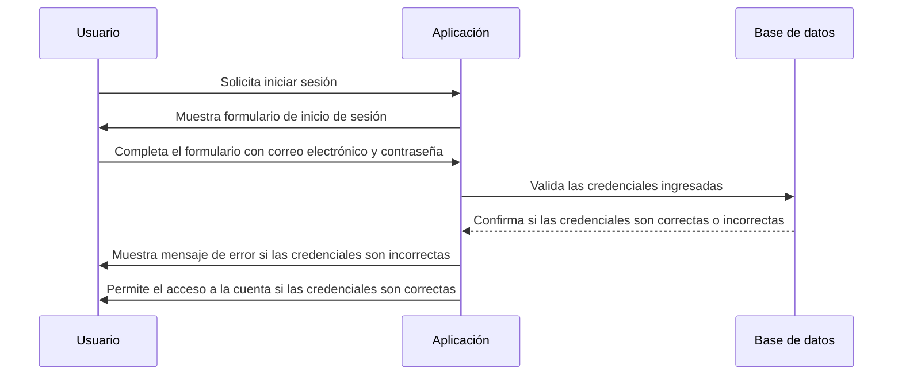

# Inicio de sesión de usuario

## Overview

EventsApp permite a los usuarios iniciar sesión en la aplicación para acceder a funciones personalizadas y gestionar sus eventos. Este documento describe el proceso de inicio de sesión de usuario en la aplicación.

La aplicación tendrá una página de inicio de sesión (Login) donde los usuarios pueden ingresar su correo electrónico y contraseña para acceder a su cuenta. Una vez que el usuario ingresa sus credenciales, la aplicación validará los datos ingresados y verificará si coinciden con una cuenta existente en la base de datos.

Si las credenciales son correctas, el usuario será autenticado y podrá acceder a su cuenta y a las funciones personalizadas de la aplicación. En caso de que las credenciales sean incorrectas, se mostrará un mensaje de error indicando que el correo electrónico o la contraseña son inválidos.

## Flujo de secuencia

## Criterios de aceptación

1. La aplicación debe permitir a los usuarios ingresar su correo electrónico y contraseña en el formulario de inicio de sesión.
2. La aplicación debe validar las credenciales ingresadas y verificar si coinciden con una cuenta existente en la base de datos.
3. Si las credenciales son correctas, el usuario debe ser autenticado y redirigido a su cuenta.
4. Si las credenciales son incorrectas, la aplicación debe mostrar un mensaje de error indicando que el correo electrónico o la contraseña son inválidos.
5. La aplicación debe manejar de manera segura las credenciales del usuario, asegurando que la información sensible no se exponga ni se almacene de manera insegura.
6. La aplicación debe permitir a los usuarios cerrar sesión de manera segura, invalidando su sesión actual y redirigiéndolos a la página de inicio de sesión.
7. La aplicación debe implementar medidas de seguridad adicionales, como la protección contra ataques de fuerza bruta y la verificación de la autenticidad de las solicitudes de inicio de sesión.
