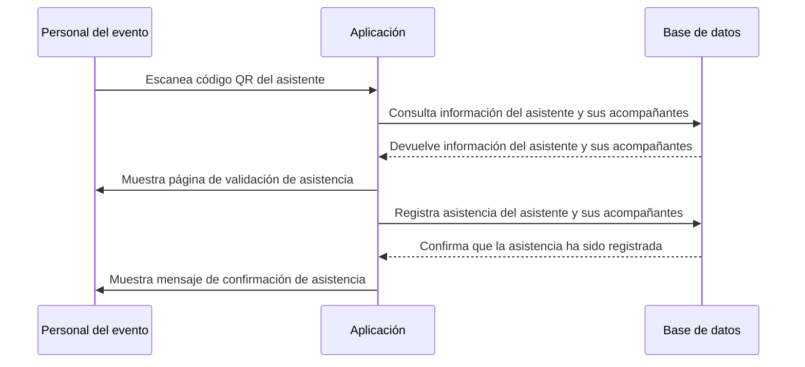

# Validar asistencia

## Overview

La validación de asistencia consiste en verificar que el asistente esté presente en el evento y que su código QR sea válido.

Cuando el evento llega a su fecha y hora programada, el asistente debe presentar su código QR de validación de asistencia generado previamente por la aplicación. El personal del evento escanea el código QR utilizando una aplicación de escaneo de códigos QR y este lo redirecciona a la página de validación de asistencia del evento en la aplicación. En esta página, la aplicación verifica la validez del código QR y confirma que el asistente está registrado para el evento. 

Si el código QR es válido, la aplicación registra la asistencia del invitado y sus acompañantes, actualiza el estado de asistencia en la base de datos y muestra un mensaje de confirmación al personal del evento con información del asistente y sus acompañantes.

## Flujo de secuencia

## Criterios de aceptación

1. La aplicación debe permitir al personal del evento escanear el código QR del asistente para acceder a la página de validación de asistencia.
2. La aplicación debe verificar la validez del código QR y confirmar que el asistente está registrado para el evento.
3. La aplicación debe registrar la asistencia del asistente y sus acompañantes en la base de datos una vez que se confirme la validez del código QR.
4. La aplicación debe mostrar un mensaje de confirmación al personal del evento indicando que la asistencia del asistente y sus acompañantes ha sido registrada exitosamente y proporcionando información relevante del evento.
5. La aplicación debe manejar de manera segura la información del asistente y sus acompañantes, asegurando que la información sensible no se exponga ni se almacene de manera insegura.
6. La aplicación debe permitir al personal del evento cancelar la asistencia de un asistente si es necesario, actualizando el estado de asistencia en la base de datos y mostrando un mensaje de confirmación de cancelación.
7. La aplicación debe implementar medidas de seguridad adicionales, como la protección contra el uso de códigos QR falsificados y la verificación de la autenticidad de las solicitudes de validación de asistencia.

